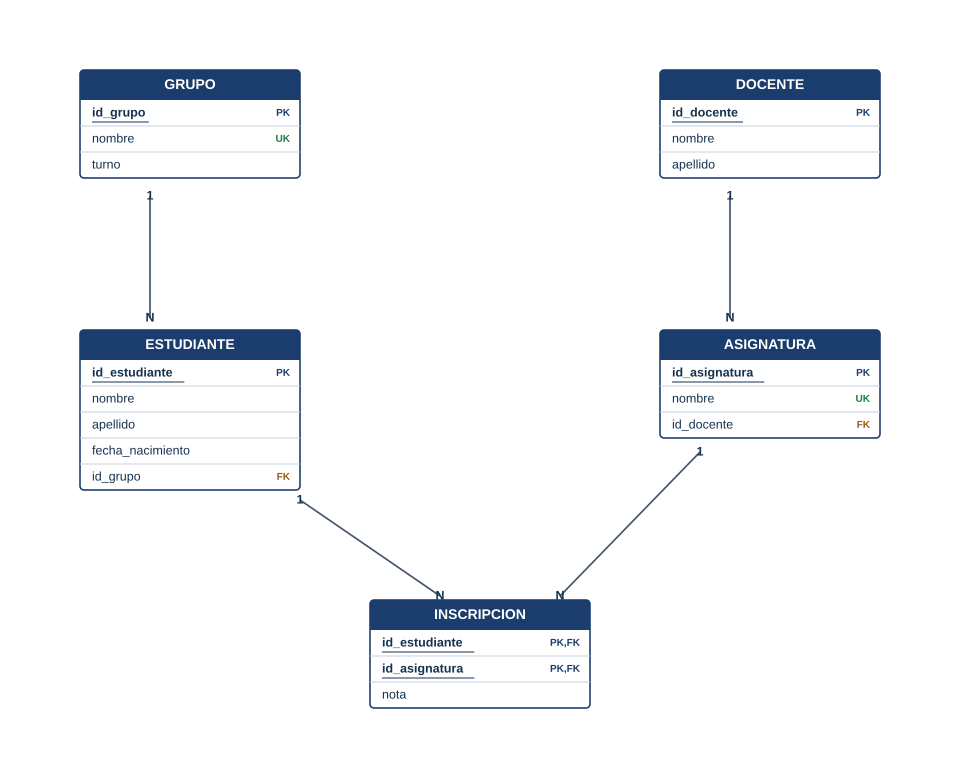

> 🗄️ **Base de datos:** `liceo` (Módulo 5 — Definición de Datos) — [⬇️ Descargar script SQL](https://github.com/adelvalle2010/conexion-base-de-datos/blob/main/scripts-sql/modulo5/liceo_ddl.sql)

# 🔧 ALTER, DROP y TRUNCATE

## ¿Por qué lo necesitamos?

Las bases de datos cambian. En el liceo ya tenemos dos cambios pendientes:

- `estudiante` guarda el grupo como texto (`'3ºA'`), pero ahora existe la tabla `grupo`. Si alguien escribe `'3A'`, ese estudiante queda en un grupo que no existe.
- A `asignatura` e `inscripcion` les faltan restricciones.

Borrar todo y volver a crear sirve mientras las tablas están vacías. Cuando tienen datos, hay que **modificar** la estructura sin perderlos.

| Sentencia | Qué hace | ¿Pierde datos? |
| --------- | -------- | -------------- |
| `ALTER TABLE` | Cambia la estructura de una tabla | Solo si se elimina una columna |
| `TRUNCATE TABLE` | Vacía la tabla; la estructura queda | Sí: todas las filas |
| `DROP TABLE` | Elimina la tabla completa | Sí: filas y estructura |

> ⚠️ **Estas tres sentencias no se pueden deshacer.** No hay papelera ni "Ctrl+Z". Antes de ejecutar un `DROP` o un `TRUNCATE`, leé dos veces el nombre de la tabla y fijate en qué base estás parado.

---

## Sintaxis

```sql
ALTER TABLE <tabla> ADD COLUMN <columna> <TIPO> <restricciones>;
ALTER TABLE <tabla> MODIFY COLUMN <columna> <NUEVO TIPO> <restricciones>;
ALTER TABLE <tabla> RENAME COLUMN <nombre_actual> TO <nombre_nuevo>;
ALTER TABLE <tabla> DROP COLUMN <columna>;
ALTER TABLE <tabla> ADD CONSTRAINT <nombre> <definición>;
ALTER TABLE <tabla> DROP CONSTRAINT <nombre>;

TRUNCATE TABLE <tabla>;
DROP TABLE <tabla>;
```

---

## Paso 1 — Agregar una columna

Cada estudiante va a apuntar a su grupo con una clave foránea. Primero, la columna:

```sql
ALTER TABLE estudiante
    ADD COLUMN id_grupo INT NOT NULL;
```

La columna nueva se agrega al final. Como la tabla está vacía, puede ser `NOT NULL` sin problemas.

> 📌 **Nota:** si la tabla ya tuviera filas, MySQL completaría la columna nueva con `0` en todas, y el paso siguiente fallaría porque no existe el grupo 0. En ese caso se agrega primero admitiendo `NULL`, se cargan los valores correctos y recién después se cambia a `NOT NULL`.

---

## Paso 2 — Agregar una restricción

```sql
ALTER TABLE estudiante
    ADD CONSTRAINT fk_estudiante_grupo FOREIGN KEY (id_grupo)
        REFERENCES grupo (id_grupo);
```

Aprovechamos para completar las reglas que quedaron pendientes:

```sql
-- No puede haber dos asignaturas con el mismo nombre
ALTER TABLE asignatura
    ADD CONSTRAINT uq_asignatura_nombre UNIQUE (nombre);

-- La nota va de 1 a 12
ALTER TABLE inscripcion
    ADD CONSTRAINT chk_inscripcion_nota CHECK (nota BETWEEN 1 AND 12);
```

**¿Qué hace exactamente?**

- Al agregar una restricción, MySQL revisa las filas **que ya existen**. Si alguna no la cumple, el `ALTER` falla y no cambia nada.
- Un `CHECK` sobre una columna que admite `NULL` acepta el `NULL`: una inscripción sin nota sigue siendo válida.

---

## Paso 3 — Eliminar una columna

La columna de texto `grupo` ya no hace falta:

```sql
ALTER TABLE estudiante
    DROP COLUMN grupo;
```

> ⚠️ **`DROP COLUMN` elimina la columna con todos sus valores.** En una tabla con datos, primero hay que haber pasado esa información a donde corresponda.

```sql
DESCRIBE estudiante;
```

**Resultado:**

| Field | Type | Null | Key | Default | Extra |
| ----- | ---- | ---- | --- | ------- | ----- |
| id_estudiante | int | NO | PRI | NULL | auto_increment |
| nombre | varchar(50) | NO | | NULL | |
| apellido | varchar(50) | NO | | NULL | |
| fecha_nacimiento | date | NO | | NULL | |
| id_grupo | int | NO | MUL | NULL | |

---

## Paso 4 — Modificar y renombrar

Para practicar sin tocar el liceo, usamos una tabla descartable:

```sql
CREATE TABLE prueba (
    id_prueba INT         NOT NULL AUTO_INCREMENT,
    texto     VARCHAR(20),
    CONSTRAINT pk_prueba PRIMARY KEY (id_prueba)
);

ALTER TABLE prueba
    ADD COLUMN fecha DATE;

ALTER TABLE prueba
    MODIFY COLUMN texto VARCHAR(100) NOT NULL;

ALTER TABLE prueba
    RENAME COLUMN texto TO descripcion;

DESCRIBE prueba;
```

**Resultado:**

| Field | Type | Null | Key | Default | Extra |
| ----- | ---- | ---- | --- | ------- | ----- |
| id_prueba | int | NO | PRI | NULL | auto_increment |
| descripcion | varchar(100) | NO | | NULL | |
| fecha | date | YES | | NULL | |

**Elementos clave:**

- `MODIFY COLUMN` **reemplaza** la definición completa: hay que volver a escribir el tipo y todas las restricciones de columna. Si se omite `NOT NULL`, la columna pasa a admitir `NULL`.
- Agrandar un tipo (`VARCHAR(20)` → `VARCHAR(100)`) es seguro. Achicarlo puede fallar o cortar datos.
- `RENAME COLUMN` cambia solo el nombre.

---

## Paso 5 — TRUNCATE: vaciar una tabla

```sql
INSERT INTO prueba (descripcion)
VALUES ('uno'), ('dos'), ('tres');

TRUNCATE TABLE prueba;

INSERT INTO prueba (descripcion)
VALUES ('cuatro');

SELECT *
FROM prueba;
```

**Resultado:**

| id_prueba | descripcion | fecha |
| --------- | ----------- | ----- |
| 1 | cuatro | NULL |

**¿Qué hace exactamente?**

- `TRUNCATE` eliminó las tres filas de una vez.
- El contador de `AUTO_INCREMENT` **volvió a 1**: por eso "cuatro" tiene `id_prueba = 1` y no 4.
- La estructura de la tabla quedó intacta.

> ⚠️ **`TRUNCATE` no admite `WHERE`:** borra todo o nada. Para borrar algunas filas se usa [DELETE](DELETE-eliminar-registros).

---

## Paso 6 — DROP: eliminar la tabla

```sql
DROP TABLE prueba;
```

```sql
SHOW TABLES;
```

**Resultado:**

| Tables_in_liceo |
| --------------- |
| asignatura |
| docente |
| estudiante |
| grupo |
| inscripcion |

`DROP TABLE IF EXISTS prueba;` hace lo mismo sin dar error si la tabla no existe.

Las claves foráneas protegen de un `DROP` equivocado:

```sql
-- ❌ asignatura apunta a docente
DROP TABLE docente;
```

```text
Error 3730: Cannot drop table 'docente' referenced by a foreign key constraint
'fk_asignatura_docente' on table 'asignatura'.
```

Para eliminar tablas relacionadas hay que seguir el orden inverso al de creación: primero las que tienen FK.

---

## El diseño final del liceo

<p align="center">
  
</p>

*Diagrama: las cinco tablas de la base `liceo` con sus claves primarias (PK), foráneas (FK) y columnas únicas (UK).*

```text
docente(id_docente PK, nombre, apellido)
grupo(id_grupo PK, nombre, turno)
estudiante(id_estudiante PK, nombre, apellido, fecha_nacimiento, id_grupo FK → grupo)
asignatura(id_asignatura PK, nombre, id_docente FK → docente)
inscripcion(id_estudiante PK/FK → estudiante, id_asignatura PK/FK → asignatura, nota)
```

Esta es la base con la que vamos a trabajar en todos los módulos que siguen.

## Diferencia clave: DELETE vs TRUNCATE vs DROP

| Aspecto | `DELETE` | `TRUNCATE` | `DROP` |
| ------- | -------- | ---------- | ------ |
| Familia | DML | DDL | DDL |
| Qué elimina | Filas | Todas las filas | La tabla entera |
| ¿Admite `WHERE`? | Sí | No | No |
| ¿Queda la estructura? | Sí | Sí | No |
| ¿Reinicia `AUTO_INCREMENT`? | No | Sí | No aplica |
| ¿Se puede deshacer con `ROLLBACK`? | Sí, dentro de una [transacción](Transacciones) | No | No |

---

## ⚠️ Errores frecuentes

| Síntoma | Causa | Solución |
| ------- | ----- | -------- |
| `Error 1060: Duplicate column name 'id_grupo'` | La columna ya existe (se ejecutó dos veces el `ALTER`) | Revisar con `DESCRIBE` antes de repetir |
| `Error 1091: Can't DROP 'grupo'; check that column/key exists` | La columna ya fue eliminada o está mal escrita | Revisar con `DESCRIBE` |
| `Error 1452` al agregar una FK | Hay filas cuyo valor no existe en la tabla referenciada | Corregir esos valores antes de agregar la restricción |
| `Error 3819` al agregar un `CHECK` | Hay filas que no cumplen la condición | Corregir los datos y volver a ejecutar |
| `Error 3730: Cannot drop table … referenced by a foreign key constraint` | Otra tabla apunta a la que se quiere eliminar | Eliminar antes la tabla hija o su FK |
| `Error 1701: Cannot truncate a table referenced in a foreign key constraint` | Se quiso truncar una tabla "padre" | Vaciar antes las tablas hijas, o usar `DELETE` |
| Después de un `MODIFY`, la columna acepta `NULL` | No se repitió `NOT NULL` | Volver a ejecutar el `MODIFY` con la definición completa |

---

## ✍️ Ejercicios

Resolvé cada uno antes de mirar la solución. Usá la base `practica`.

**1.** Agregá a `socio` una columna `email` de hasta 100 caracteres, opcional, y hacé que no se pueda repetir.

<details>
<summary>Ver solución</summary>

```sql
ALTER TABLE socio
    ADD COLUMN email VARCHAR(100);

ALTER TABLE socio
    ADD CONSTRAINT uq_socio_email UNIQUE (email);
```

💡 Una columna `UNIQUE` que admite `NULL` puede tener varios socios sin correo: los `NULL` no cuentan como repetidos.
</details>

**2.** Relacioná `libro` con `editorial`: cada libro puede tener una editorial o ninguna. Si se borra una editorial, sus libros deben quedar sin editorial.

<details>
<summary>Ver solución</summary>

```sql
ALTER TABLE libro
    ADD COLUMN id_editorial INT NULL;

ALTER TABLE libro
    ADD CONSTRAINT fk_libro_editorial FOREIGN KEY (id_editorial)
        REFERENCES editorial (id_editorial)
        ON DELETE SET NULL;
```

💡 `ON DELETE SET NULL` exige que la columna admita `NULL`.
</details>

**3.** En `ejemplar`, hacé que `estado` valga `'disponible'` por defecto y que solo admita `'disponible'`, `'prestado'` o `'en reparación'`.

<details>
<summary>Ver solución</summary>

```sql
ALTER TABLE ejemplar
    MODIFY COLUMN estado VARCHAR(20) NOT NULL DEFAULT 'disponible';

ALTER TABLE ejemplar
    ADD CONSTRAINT chk_ejemplar_estado
        CHECK (estado IN ('disponible', 'prestado', 'en reparación'));
```

💡 En el `MODIFY` hay que repetir `VARCHAR(20) NOT NULL`: la sentencia reemplaza toda la definición de la columna.
</details>

**4.** Eliminá las tablas `prestamo`, `ejemplar` y `libro`. ¿En qué orden hay que hacerlo?

<details>
<summary>Ver solución</summary>

```sql
DROP TABLE prestamo;
DROP TABLE ejemplar;
DROP TABLE libro;
```

💡 Orden inverso al de creación: `prestamo` apunta a `ejemplar`, y `ejemplar` apunta a `libro`. También se puede escribir `DROP TABLE prestamo, ejemplar, libro;`.
</details>

---

## 📋 Palabras clave

`ALTER TABLE` · `ADD COLUMN` · `MODIFY COLUMN` · `RENAME COLUMN` · `DROP COLUMN` · `ADD CONSTRAINT` · `DROP CONSTRAINT` · `TRUNCATE` · `DROP TABLE` · `IF EXISTS` · `AUTO_INCREMENT` · `irreversible` · `orden de dependencia` · `DDL`

---

🧠 **[Autoevaluación — Módulo 5](auto-modulo5)**

---

← [Restricciones: NOT NULL, UNIQUE, DEFAULT y CHECK](Restricciones) · [🏠 Inicio](Home) · [Resumen del Módulo 5 →](Resumen-Modulo5)
