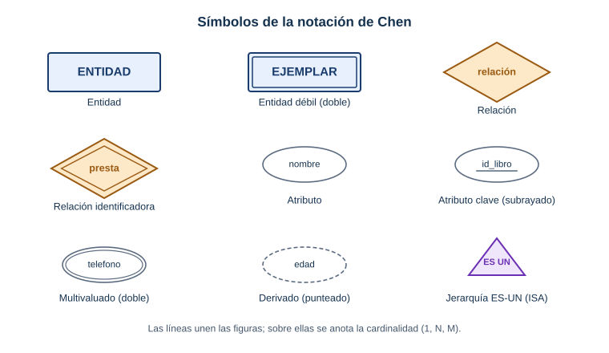

# 📐 Anexo: Notaciones de diagramas (Chen y pata de gallo)

Un mismo modelo de datos se puede dibujar de varias formas. En el curso usamos dos: la **notación de Chen** (la del diseño conceptual, con rombos) y la **notación de pata de gallo** o *crow's foot* (la de las herramientas como Workbench). Esta página las compara.

> 🗒️ Chuleta de referencia. El modelo es el mismo; cambia solo cómo se dibuja.

---

## 1. Notación de Chen

Es la clásica del **diseño conceptual** (Módulo 1). Separa las cosas en tres figuras: entidades, relaciones y atributos.

<p align="center">
  
</p>

| Símbolo | Significado |
| ------- | ----------- |
| **Rectángulo** | Entidad (ej. `ESTUDIANTE`, `LIBRO`) |
| **Rectángulo doble** | Entidad débil (no existe sin otra; ej. un `EJEMPLAR` depende de su `LIBRO`) |
| **Rombo** | Relación (ej. *presta*, *escribe*) |
| **Rombo doble** | Relación identificadora (la que conecta una entidad débil) |
| **Óvalo** | Atributo (ej. `nombre`, `anio`) |
| **Óvalo con subrayado** | Atributo clave (la clave primaria) |
| **Óvalo doble** | Atributo multivaluado (puede tener varios valores; ej. varios `telefono`) |
| **Óvalo punteado** | Atributo derivado (se calcula; ej. `edad` a partir de la fecha de nacimiento) |
| **Triángulo (ES-UN)** | Jerarquía / herencia entre entidades |

Sobre las líneas que unen las figuras se anota la **cardinalidad**: `1`, `N` o `M`.

### Ejemplo del curso
El MER de la biblioteca del liceo está hecho en esta notación: entidades en rectángulos, *presta* y *escribe* en rombos, los atributos en óvalos. Lo podés ver en la **[Fase 1 del Proyecto Integrador](Proyecto-Fase-1-Diseno)**.

---

## 2. Notación de pata de gallo (crow's foot)

Es la que usan MySQL Workbench y casi todas las herramientas. Se parece más al resultado final: cada **entidad es una tabla** con sus columnas adentro, y las relaciones son **líneas** cuyos extremos indican la cardinalidad con símbolos.

```text
┌─────────────┐              ┌─────────────┐
│   GRUPO     │              │ ESTUDIANTE  │
├─────────────┤             ╱├─────────────┤
│ PK id_grupo │────────────○┤ PK id_est.  │
│    nombre   │ 1          N │ FK id_grupo │
│    turno    │              │    nombre   │
└─────────────┘              └─────────────┘
   "un grupo"            "muchos estudiantes"
```

Los símbolos en los extremos de la línea:

| Símbolo | Lee como |
| ------- | -------- |
| Una raya `│` | "uno (obligatorio)" |
| Un círculo `○` | "cero (opcional)" |
| La pata de gallo `<` | "muchos" |
| Círculo + pata `○<` | "cero o muchos" |
| Raya + pata `│<` | "uno o muchos" |

Así, una raya de un lado y una pata de gallo del otro significa **1:N**.

---

## 3. ¿Cuándo usar cada una?

| | Chen | Pata de gallo |
| --- | ---- | ------------- |
| **Momento** | Diseño conceptual (al pensar) | Diseño lógico / físico (al implementar) |
| **Muestra** | Entidades, relaciones y atributos por separado | Tablas con sus columnas y claves |
| **Herramienta** | Papel, pizarra, dibujo | Workbench, dbdiagram, DBeaver |
| **Atributos** | Óvalos aparte | Filas dentro de la tabla |

> 💡 Regla práctica: **Chen para pensar el modelo, pata de gallo para dibujar las tablas ya decididas.** Las dos dicen lo mismo; son dos idiomas para el mismo diseño.

---

## 4. Las cardinalidades, en palabras

| Cardinalidad | Significa | Ejemplo en el liceo |
| ------------ | --------- | ------------------- |
| **1:1** | una fila de A ↔ una fila de B | una persona ↔ un documento de identidad |
| **1:N** | una fila de A ↔ muchas de B | un grupo tiene muchos estudiantes |
| **N:M** | muchas de A ↔ muchas de B | muchos ejemplares ↔ muchos estudiantes (préstamos) |

Recordá: toda relación **N:M** se convierte, al pasar a tablas, en una **tabla intermedia**.

---

← [Errores frecuentes](Anexo-Errores-frecuentes-de-MySQL) · [🏠 Inicio](Home) · [Buenas prácticas →](Anexo-Buenas-practicas)
