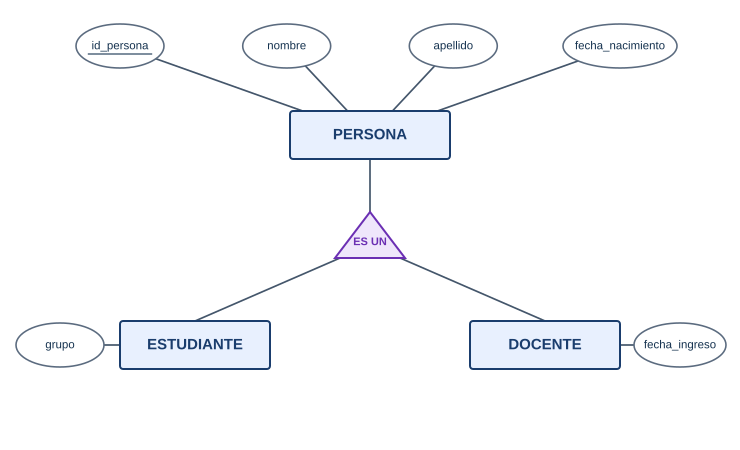

## ¿Qué es la generalización / especialización?

Mirá las entidades ESTUDIANTE y DOCENTE del liceo: las dos tienen `nombre` y `apellido`, y si mañana pedimos cédula, dirección y teléfono, también los tendrían las dos. Eso pasa porque ambas son **personas**. La **generalización / especialización** es la forma de representar que varias entidades comparten atributos: se agrupa lo común en una entidad "madre" (**supertipo**) y lo particular queda en las entidades "hijas" (**subtipos**).

**Características principales:**

- Los subtipos **heredan** todos los atributos del supertipo, incluido el identificador.
- Cada subtipo puede tener atributos y relaciones propias.
- Se lee con la frase "**es un**": un estudiante *es una* persona.
- Forma parte del modelo Entidad-Relación **extendido** (EER).

  

*Diagrama: PERSONA es el supertipo con los atributos comunes; ESTUDIANTE y DOCENTE son subtipos con sus atributos propios.*

**Elementos clave:**

- `nombre` y `apellido` se definen una sola vez, en PERSONA.
- `grupo` solo tiene sentido para un estudiante; `fecha_ingreso`, solo para un docente.
- Son dos caminos hacia el mismo dibujo: **generalizar** es ir de abajo hacia arriba (descubrir lo común); **especializar** es ir de arriba hacia abajo (separar lo particular).

## Dos preguntas que definen el tipo

### 1. Exclusividad: ¿puede ser de más de un subtipo?

- **Exclusiva** (o disjunta): cada persona pertenece a un solo subtipo. En nuestro liceo, nadie es estudiante y docente a la vez.
- **Solapada**: una persona puede estar en varios subtipos. Ejemplo: en un club, alguien puede ser SOCIO y también ENTRENADOR.

### 2. Cobertura: ¿todos están en algún subtipo?

- **Total**: toda persona registrada es estudiante o es docente. No hay personas "sueltas".
- **Parcial**: puede haber personas que no son ninguno de los subtipos (por ejemplo, un funcionario administrativo, si no creamos un subtipo para él).

### Las cuatro combinaciones

| | Total | Parcial |
| - | ----- | ------- |
| **Exclusiva** | Todos son de exactamente un subtipo | Algunos no son de ninguno; nadie es de dos |
| **Solapada** | Todos son de al menos un subtipo | Cualquier combinación, incluso ninguno |

**¿Cuándo usar cada uno?**

- No se "elige": se **averigua** preguntando a quien conoce el sistema. "¿Puede un docente estar inscripto como estudiante?" "¿Registramos a alguien que no sea ni estudiante ni docente?"
- En el liceo de esta wiki la respuesta a las dos es no: la especialización es **exclusiva y total**.

## ¿Cuándo conviene y cuándo no?

Conviene especializar cuando:

- Los subtipos tienen **atributos propios** (`grupo`, `fecha_ingreso`).
- Los subtipos tienen **relaciones propias**: solo los docentes dictan asignaturas; solo los estudiantes se inscriben.

No conviene cuando la única diferencia es un dato. Si los docentes se distinguen solo por ser "efectivos" o "interinos", alcanza con un atributo `caracter` en DOCENTE.

> 📌 **Nota:** en el resto de la wiki seguimos usando `estudiante` y `docente` como tablas separadas, sin `persona`. No es un descuido: es una de las formas válidas de llevar una especialización exclusiva y total a tablas, y la explicamos en [Pasaje a tablas: casos especiales](Pasaje-a-tablas-casos-especiales).

## Diferencia clave: Subtipo vs Atributo

| Aspecto | Crear subtipos | Usar un atributo |
| ------- | -------------- | ---------------- |
| Ejemplo | ESTUDIANTE y DOCENTE | `caracter` = efectivo / interino |
| Atributos propios de cada caso | Sí | No |
| Relaciones propias de cada caso | Sí | No |
| Complejidad del diagrama | Mayor | Menor |
| Cuándo usar | Los casos se comportan distinto | Los casos solo se llaman distinto |

---

## 📋 Palabras clave

`generalización` · `especialización` · `supertipo` · `subtipo` · `herencia` · `es un` · `exclusiva (disjunta)` · `solapada` · `total` · `parcial` · `modelo EER` · `atributo propio`

---

🧠 **[Autoevaluación — Módulo 2](auto-modulo2)**

---

← [Relaciones reflexivas](Relaciones-reflexivas) · [🏠 Inicio](Home) · [Pasaje a tablas: casos especiales →](Pasaje-a-tablas-casos-especiales)
