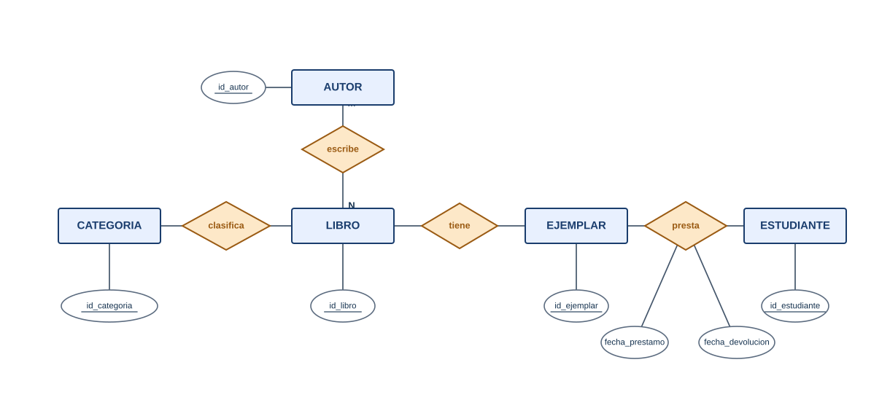

> 🗄️ **Base de datos:** `biblioteca_liceo` (Módulo 12 — Proyecto Integrador) — [⬇️ Descargar script SQL](https://github.com/adelvalle2010/conexion-base-de-datos/blob/main/scripts-sql/modulo12/proyecto_integrador.sql)

# 📐 Fase 1 — Diseño: del problema al MER

Antes de escribir una sola línea de SQL, hay que **pensar** la base. Esta fase es la del diseño conceptual (Módulo 1) y el pasaje a tablas (Módulos 2 y 3).

## Paso 1 — Identificar las entidades

Leyendo el enunciado, subrayamos los sustantivos importantes. Las cosas de las que la biblioteca necesita guardar datos son:

- **ESTUDIANTE** — el socio que pide libros (ya existía en el liceo).
- **LIBRO** — la obra (ej. *La tregua*). No es el objeto físico, sino el título.
- **EJEMPLAR** — cada copia física de un libro. De *La tregua* puede haber dos ejemplares.
- **AUTOR** — quién escribió el libro.
- **CATEGORIA** — a qué tipo pertenece el libro (Novela, Historia…).

> 📌 **La distinción clave: LIBRO vs EJEMPLAR.** El estudiante pide prestado un **ejemplar** (una copia concreta), no "el libro" en abstracto. Por eso son dos entidades: un libro tiene muchos ejemplares, y el préstamo es siempre de un ejemplar.

## Paso 2 — Identificar las relaciones y sus cardinalidades

| Entre… | Relación | Cardinalidad | Por qué |
| ------ | -------- | ------------ | ------- |
| CATEGORIA – LIBRO | *clasifica* | **1:N** | Una categoría agrupa muchos libros; cada libro es de una sola categoría |
| LIBRO – AUTOR | *escribe* | **N:M** | Un libro puede tener varios autores y un autor escribe varios libros |
| LIBRO – EJEMPLAR | *tiene* | **1:N** | Un libro tiene varios ejemplares; cada ejemplar es de un solo libro |
| EJEMPLAR – ESTUDIANTE | *presta* | **N:M** | Un ejemplar se presta muchas veces (a lo largo del tiempo) y un estudiante pide muchos ejemplares |

## Paso 3 — El Modelo Entidad-Relación (notación de Chen)

Con las entidades, sus atributos y las relaciones, armamos el MER. Rectángulos para entidades, rombos para relaciones, óvalos para atributos y el atributo clave subrayado:

<p align="center">
  
</p>

> 💡 La relación *presta* (N:M) tiene **atributos propios**: `fecha_prestamo` y `fecha_devolucion`. Eso es señal segura de que, al pasar a tablas, se convertirá en una tabla propia.

## Paso 4 — Pasaje a tablas (modelo relacional)

Aplicamos las reglas del Módulo 2:

- Cada **entidad** → una tabla, con su clave primaria.
- Cada relación **1:N** → la clave de la entidad del lado "1" baja como **clave foránea** al lado "N".
- Cada relación **N:M** → una **tabla intermedia** con las dos claves.

El esquema relacional queda así (PK en **negrita**, FK con →):

```text
grupo(id_grupo, nombre, turno)

estudiante(id_estudiante, nombre, apellido, id_grupo → grupo)

categoria(id_categoria, nombre)

autor(id_autor, nombre, apellido)

libro(id_libro, titulo, anio, id_categoria → categoria)

libro_autor(id_libro → libro, id_autor → autor)        ← N:M entre libro y autor

ejemplar(id_ejemplar, id_libro → libro, estado)

prestamo(id_prestamo, id_ejemplar → ejemplar,
         id_estudiante → estudiante,
         fecha_prestamo, fecha_devolucion_pactada, fecha_devolucion_real)
```

Detalles del diseño:

- `libro_autor` tiene **clave primaria compuesta** `(id_libro, id_autor)`: así un mismo autor no puede figurar dos veces en el mismo libro.
- La relación N:M **EJEMPLAR–ESTUDIANTE** se resuelve con la tabla `prestamo`, que además guarda las fechas (los atributos de la relación).
- `estado` en `ejemplar` guarda si está `disponible`, `prestado` o de `baja`.

## Paso 5 — ¿Está normalizado?

Repasamos las formas normales (Módulo 3):

- **1FN**: todos los campos son atómicos (no hay "autores" en una sola celda separados por comas) → por eso existe `libro_autor`. ✅
- **2FN**: no hay dependencias parciales; cada tabla tiene una PK y los atributos dependen de ella entera. ✅
- **3FN**: no guardamos datos derivados ni dependencias transitivas (la categoría está en su tabla, no repetida como texto en cada libro). ✅

El diseño está en **3FN**. Pasamos a construirlo.

---

Continuamos con la implementación → [Fase 2: Crear y poblar la base](Proyecto-Fase-2-Implementacion)

---

## ✍️ Ejercicios

**1.** En el MER, ¿por qué *presta* es N:M y no 1:N? Justificá con un ejemplo.

<details>
<summary>Ver solución</summary>

Porque **el mismo ejemplar se presta muchas veces a lo largo del tiempo** (hoy a Lucía, el mes que viene a Mateo) y **un estudiante pide muchos ejemplares**. Ninguno de los dos lados está limitado a uno, así que es N:M. Si un ejemplar solo pudiera prestarse una vez en toda su vida, sería 1:N.
</details>

**2.** ¿Qué pasaría si guardáramos el autor como una columna de texto dentro de `libro` en vez de tener `autor` y `libro_autor`?

<details>
<summary>Ver solución</summary>

Se rompería la **1FN** en cuanto un libro tuviera dos autores (habría que meter "Benedetti, Vilariño" en una celda). Además habría **datos repetidos** (el nombre del autor escrito igual en cada libro suyo) y sería imposible corregir un apellido mal escrito en un solo lugar. Por eso el autor es una entidad aparte.
</details>

**3.** Dibujá (o describí) cómo cambiaría el MER si además quisiéramos registrar la **editorial** de cada libro.

<details>
<summary>Ver solución</summary>

Se agrega una entidad **EDITORIAL** (`id_editorial`, `nombre`) y una relación **1:N** *publica* entre EDITORIAL y LIBRO (una editorial publica muchos libros; cada libro es de una editorial). Al pasar a tablas, `libro` recibe una FK `id_editorial → editorial`.
</details>

---

## 📋 Palabras clave

`entidad` · `relación` · `cardinalidad` · `1:N` · `N:M` · `tabla intermedia` · `clave primaria` · `clave foránea` · `clave compuesta` · `LIBRO vs EJEMPLAR` · `normalización` · `3FN`

---

🧠 **[Autoevaluación — Módulo 12](auto-modulo12)**

---

← [Introducción](Introduccion-Proyecto-Integrador) · [🏠 Inicio](Home) · [Fase 2: Implementación →](Proyecto-Fase-2-Implementacion)
