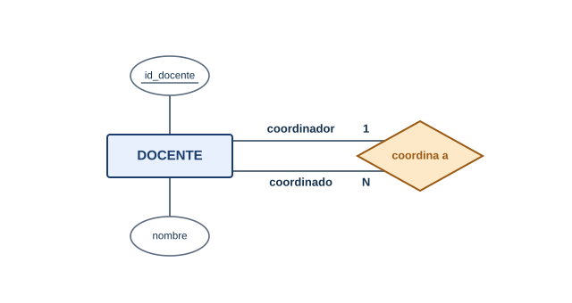
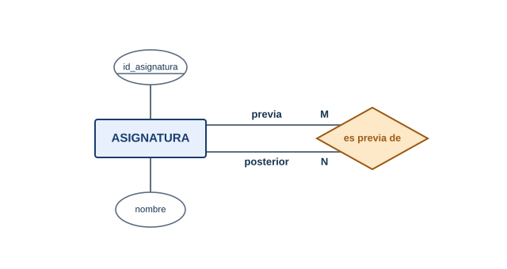

## ¿Qué es una relación reflexiva?

Hasta ahora todas las relaciones unían dos entidades distintas: DOCENTE con ASIGNATURA, ESTUDIANTE con ASIGNATURA. Pero en el liceo también pasa esto: algunos docentes son **coordinadores** de otros docentes. El coordinador no es otra clase de cosa: es un docente más. Una **relación reflexiva** (también llamada recursiva o unaria) es una relación que une a una entidad **consigo misma**.

**Características principales:**

- Participa una sola entidad, pero cumpliendo **dos roles** distintos.
- Tiene cardinalidad como cualquier otra relación: 1:1, 1:N o N:M.
- En el dibujo, las dos líneas de la relación salen y vuelven a la misma entidad.
- Conviene escribir el nombre de cada rol sobre las líneas para que se entienda quién es quién.

## Reflexiva 1:N: el coordinador

Un docente coordina a varios docentes; cada docente tiene, como máximo, un coordinador.

  

*Diagrama: la entidad DOCENTE se relaciona consigo misma; un docente coordina a muchos y cada uno tiene a lo sumo un coordinador.*

| id_docente | nombre | apellido | coordinado por |
| ---------- | ------ | -------- | -------------- |
| 1 | Ana | Pereira | — |
| 2 | Carlos | Méndez | Ana Pereira |
| 3 | Laura | Sosa | Ana Pereira |
| 4 | Diego | Olivera | — |

**Elementos clave:**

- Los dos roles son **coordinador** y **coordinado**. Ana cumple el primero; Carlos y Laura, el segundo.
- Ana y Diego no tienen coordinador: la participación es opcional (mínimo 0). Si fuera obligatoria para todos, ¿quién coordinaría al primero?
- No hace falta una entidad COORDINADOR: guardaríamos dos veces los mismos datos de la misma persona.

## Reflexiva N:M: las previaturas

Para cursar Matemática II hay que haber aprobado Matemática I. Una asignatura puede tener varias **previas**, y una asignatura puede ser previa de varias.

  

*Diagrama: la entidad ASIGNATURA se relaciona consigo misma con cardinalidad muchos a muchos.*

**¿Qué hace exactamente?**

- Los roles son **previa** y **habilitada**.
- Al ser N:M, al pasar a tablas va a necesitar una tabla intermedia, igual que cualquier otra relación N:M. Lo verás en [Pasaje a tablas: casos especiales](Pasaje-a-tablas-casos-especiales).

## ¿Cómo me doy cuenta de que la relación es reflexiva?

Preguntate: **¿las dos puntas de la relación son el mismo tipo de cosa?**

- "Un empleado es jefe de otros empleados" → sí, reflexiva.
- "Una persona es madre o padre de otra persona" → sí, reflexiva.
- "Un docente dicta asignaturas" → no, son dos entidades.

Otros casos conocidos son los seguidores de una red social (un usuario sigue a otros usuarios), los subproyectos de un proyecto y las categorías que contienen subcategorías, entre muchos otros.

## Diferencia clave: Relación reflexiva vs Entidad nueva

| Aspecto | Relación reflexiva | Crear otra entidad (COORDINADOR) |
| ------- | ------------------ | -------------------------------- |
| Datos de la persona | Se guardan una sola vez | Se repiten en dos lugares |
| Si un coordinador deja de serlo | Cambia un dato de la relación | Hay que mover datos de una entidad a otra |
| Cantidad de entidades | Una | Dos |
| Riesgo | Olvidar nombrar los roles | Datos duplicados e incoherentes |
| Cuándo conviene | Los dos roles son el mismo tipo de cosa | El rol tiene muchos datos propios (ver [Generalización y especialización](Generalizacion-y-especializacion)) |

---

## 📋 Palabras clave

`relación reflexiva` · `relación recursiva` · `relación unaria` · `rol` · `coordinador` · `jerarquía` · `previatura` · `cardinalidad` · `participación opcional` · `1:N` · `N:M` · `duplicación de datos`

---

🧠 **[Autoevaluación — Módulo 2](auto-modulo2)**

---

← [Entidades débiles](Entidades-debiles) · [🏠 Inicio](Home) · [Generalización y especialización →](Generalizacion-y-especializacion)
