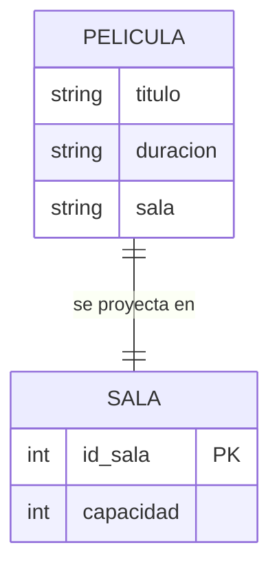

## Ejercicios: Entidad-Relación

En estos ejercicios vas a practicar cómo pasar de un enunciado a un diagrama E-R. Necesitás lápiz y papel, o cualquier herramienta con la que te guste dibujar. Si querés, también podés escribirlos con la sintaxis `mermaid` que viste en [Entidad-Relación](Entidad-Relacion).

**Datos de partida:** cada ejercicio trae su propio enunciado. Para que practiques sin copiar el ejemplo de clase, ninguno usa el liceo.

En todos, indicá: entidades, atributos, identificador de cada entidad, relaciones y su cardinalidad.

---

### Ejercicio 1 ★

Una biblioteca presta libros a sus socios. De cada libro se guarda el título y el autor; de cada socio, el nombre y el apellido. Un socio puede llevarse muchos libros a lo largo del tiempo, y un mismo libro es prestado a distintos socios en distintos momentos. De cada préstamo interesa la fecha de préstamo y la de devolución.

Identificá las entidades, sus atributos e identificadores, la relación con su cardinalidad y dónde ubicás las dos fechas.

---

### Ejercicio 2 ★

Un club deportivo ofrece actividades (fútbol, natación, básquet...). De cada socio se guardan nombre y apellido; de cada actividad, el nombre y el horario. Un socio puede anotarse en varias actividades y cada actividad tiene muchos socios. Interesa saber en qué fecha se anotó cada socio en cada actividad.

Dibujá el diagrama y explicá a qué pertenece la fecha de alta y por qué.

---

### Ejercicio 3 ★★

En una clínica trabajan médicos, y cada médico tiene una única especialidad (pediatría, cardiología...). Una misma especialidad la tienen varios médicos. Los pacientes se atienden con distintos médicos y cada médico atiende a muchos pacientes. De cada consulta se anota la fecha, la hora y el diagnóstico.

Dibujá el diagrama con sus cuatro elementos (especialidad, médico, paciente y la consulta como relación) e indicá las cardinalidades.

💡 Pista

Hay una relación 1:N y una N:M. Preguntate: ¿el diagnóstico es del paciente, del médico o de cada consulta?

---

### Ejercicio 4 ★★

Una tienda online registra clientes, pedidos y productos. Un cliente hace muchos pedidos, pero cada pedido es de un único cliente. Un pedido incluye varios productos y un producto puede estar en muchos pedidos; de cada producto dentro de un pedido se anota la cantidad.

**a)** Dibujá el diagrama.

**b)** Predicción: ¿qué cardinalidad tendría la relación cliente–pedido si la tienda permitiera **un solo pedido por cliente en toda su vida**? ¿Seguiría teniendo sentido tener dos entidades separadas?

💡 Pista

Para la parte b), cambiá la pregunta en las dos direcciones: ¿cuántos pedidos puede tener un cliente? ¿Y cuántos clientes puede tener un pedido?

---

### Ejercicio 5 ★★★

Un compañero diseñó este diagrama para un cine y te pide que lo revises. Tiene **al menos tres errores**.

Encontrá los errores, explicá por qué lo son y dibujá la versión corregida. Tené en cuenta que una película se proyecta en varias salas y que una sala proyecta varias películas a lo largo del día.

💡 Pista

Mirá tres cosas: si cada entidad tiene su identificador, si algún atributo está repitiendo lo que ya expresa una relación, y si la cardinalidad dibujada coincide con el enunciado.

---

👉 Cuando termines, compará con la [Solución: Entidad-Relación](Solucion-Entidad-Relacion).

---

← [Entidad-Relación](Entidad-Relacion) · [🏠 Inicio](Home) · [Solución: Entidad-Relación →](Solucion-Entidad-Relacion)
