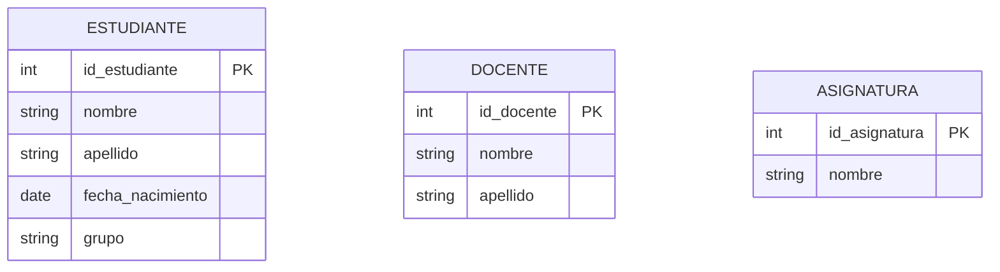
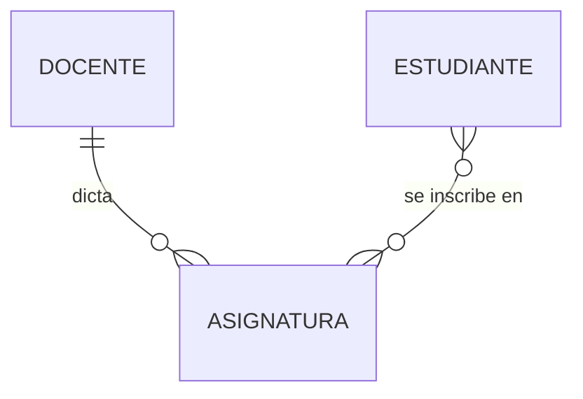
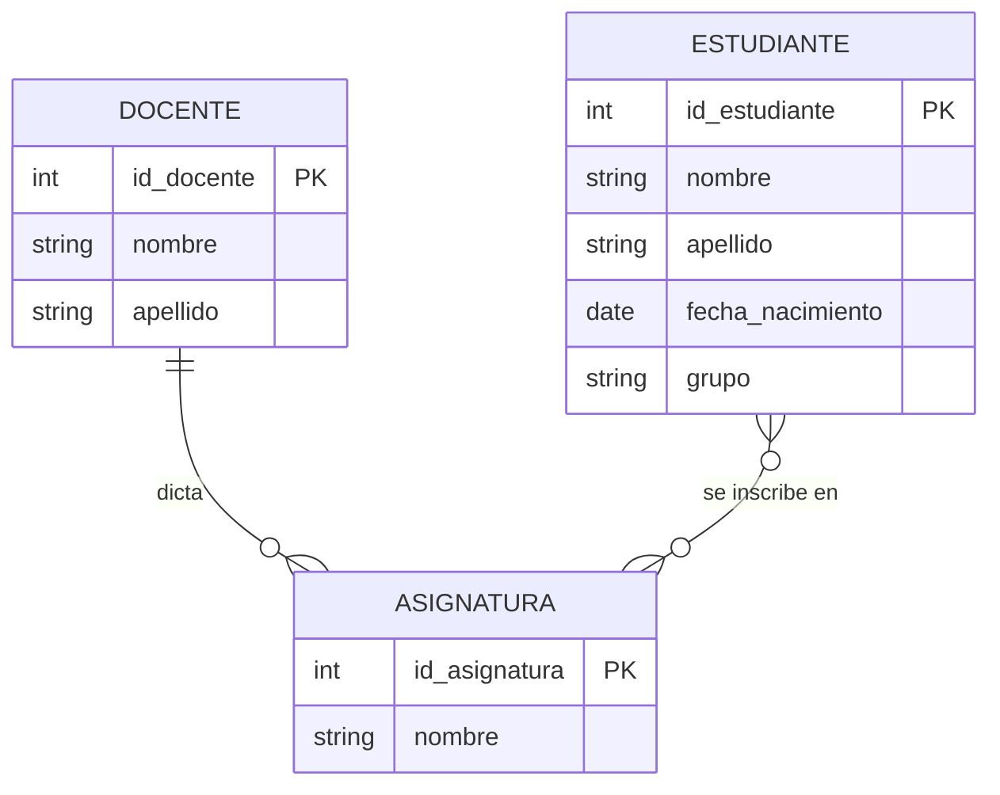

## ¿Qué es el modelo Entidad-Relación?

El **modelo Entidad-Relación (E-R)** es una forma de representar, con un diagrama, qué cosas maneja un sistema, qué datos interesan de cada una y cómo se vinculan entre sí. Es el primer paso del diseño de una base de datos: el plano que se dibuja antes de crear una sola tabla, igual que se hace el plano de una casa antes de construirla.

**Características principales:**

- Es un dibujo: se entiende sin saber programar.
- No depende del SGBD: el mismo diagrama sirve para MySQL, PostgreSQL u otro.
- Se puede revisar con quien va a usar el sistema ("¿falta algo?") antes de invertir tiempo en programar.
- Más adelante se traduce a tablas en el [Modelo Relacional](Modelo-Relacional).

## Las tres piezas del diagrama

### 1. Entidades

Una **entidad** es un tipo de cosa del mundo real sobre la que queremos guardar datos: una persona, un objeto, un lugar o un hecho. En el liceo, las entidades son:

- ESTUDIANTE
- DOCENTE
- ASIGNATURA

**Elementos clave:**

- Se nombran en singular y en mayúsculas: ESTUDIANTE, no "estudiantes".
- Representan un *tipo* de cosa, no una en particular: ESTUDIANTE es la idea general; "Lucía Fernández" será una fila de la tabla más adelante.

### 2. Atributos

Un **atributo** es una característica de una entidad: un dato que queremos guardar de ella.

*Diagrama: tres entidades del liceo, cada una con sus atributos; la marca PK señala el identificador.*

**Elementos clave:**

- `PK` marca el **identificador**: el atributo (o conjunto de atributos) que distingue a cada ejemplar de la entidad.
- Dos estudiantes pueden llamarse igual, pero no pueden tener el mismo `id_estudiante`. Por eso el nombre no sirve como identificador.
- Los tipos que muestra el dibujo (`int`, `string`, `date`) son solo una pista. Los tipos reales de MySQL se ven en [Tipos de Datos en MySQL](Tipos-de-datos-en-MySQL).

### 3. Relaciones

Una **relación** une dos entidades y suele expresarse con un verbo: el docente *dicta* asignaturas, el estudiante *se inscribe en* asignaturas.

*Diagrama: un docente dicta varias asignaturas; los estudiantes se inscriben en varias asignaturas y cada asignatura tiene varios estudiantes.*

**¿Qué hace exactamente?**

- Este dibujo usa la notación de **patas de gallo**, una de las más usadas.
- `||` significa "exactamente uno"; `o{` significa "cero o muchos".
- `DOCENTE ||--o{ ASIGNATURA`: cada asignatura tiene exactamente un docente, y un docente puede dictar muchas asignaturas.
- `ESTUDIANTE }o--o{ ASIGNATURA`: un estudiante puede cursar muchas asignaturas y una asignatura puede tener muchos estudiantes.

## Cardinalidad

La **cardinalidad** indica cuántos ejemplares de una entidad se pueden relacionar con cuántos de la otra. Hay tres casos:

| Tipo | Se lee                 | Ejemplo en el liceo                                                                 | En el dibujo |
| ---- | ---------------------- | ----------------------------------------------------------------------------------- | ------------ |
| 1:1  | uno a uno              | Un estudiante tiene un único carné, y cada carné pertenece a un solo estudiante     | `\|\|--\|\|` |
| 1:N  | uno a muchos           | Un docente dicta muchas asignaturas; cada asignatura la dicta un solo docente       | `\|\|--o{`   |
| N:M  | muchos a muchos        | Un estudiante cursa muchas asignaturas; una asignatura tiene muchos estudiantes     | `}o--o{`     |

**¿Cuándo usar cada uno?**

- **1:1**: es poco frecuente. Cuando aparece, conviene preguntarse si en realidad no se trata de una sola entidad.
- **1:N**: es la más común. Aparece cuando "uno" tiene "muchos", pero cada "muchos" pertenece a un solo "uno".
- **N:M**: aparece cuando "muchos" se relacionan con "muchos". Pide atención especial al pasar a tablas, como verás en el [Modelo Relacional](Modelo-Relacional).

Una forma segura de decidir la cardinalidad es preguntar en **las dos direcciones**: "¿un docente puede dictar muchas asignaturas?" (sí) y "¿una asignatura puede ser dictada por muchos docentes?" (en nuestro liceo, no). Resultado: 1:N.

## ¿Dónde va la nota?

Los estudiantes obtienen una nota en cada asignatura. ¿A qué pertenece ese dato?

- No es un atributo de ESTUDIANTE: cada estudiante tiene una nota distinta en cada asignatura.
- No es un atributo de ASIGNATURA: cada asignatura tiene una nota distinta para cada estudiante.
- Pertenece a la **relación** "se inscribe en": es un dato del *par* (estudiante, asignatura).

**¿Qué hace exactamente?**

- La nota es un **atributo de relación**.
- Es habitual en las relaciones N:M (la cantidad en un pedido, la fecha de un préstamo...).
- El dibujo con patas de gallo no puede mostrarlo, así que se anota aparte: `nota` pertenece a "se inscribe en".

## Paso a paso: cómo armar un diagrama E-R

1. Leé el enunciado y subrayá los **sustantivos** importantes: son candidatos a entidades.
2. Subrayá los **verbos** que unen dos entidades: son las relaciones.
3. Para cada entidad, listá los datos que interesan: son los atributos.
4. Elegí el **identificador** de cada entidad.
5. Definí la **cardinalidad** de cada relación, preguntando en ambas direcciones.
6. Revisá si alguna relación necesita sus propios atributos (como `nota`).

El resultado para el liceo es este:

*Diagrama completo del liceo: tres entidades con sus atributos y dos relaciones. La relación "se inscribe en" lleva además el atributo `nota`.*

## Diferencia clave: Entidad vs Atributo

Una confusión muy común es no saber si algo debe ser una entidad o un atributo.

| Aspecto                       | Entidad                                      | Atributo                                      |
| ----------------------------- | -------------------------------------------- | --------------------------------------------- |
| Qué es                        | Un tipo de cosa sobre la que se guardan datos | Una característica de esa cosa                |
| Ejemplo                       | ESTUDIANTE                                   | `nombre`, `grupo`                             |
| Tiene sus propios datos       | Sí                                           | No: es un dato                                |
| Puede relacionarse con otras  | Sí                                           | No: solo pertenece a su entidad               |
| Cómo decidir                  | Si interesan varios datos sobre ella         | Si es un dato simple y suelto                 |
| En el modelo relacional será  | Una tabla                                    | Una columna                                   |

**Regla práctica:** si de "eso" necesitás guardar más de un dato, probablemente sea una entidad (del docente guardamos nombre y apellido). Si es un único dato suelto, es un atributo (la fecha de nacimiento del estudiante).

---

## 📋 Palabras clave

`modelo E-R` · `diagrama` · `entidad` · `atributo` · `identificador` · `relación` · `cardinalidad` · `1:1` · `1:N` · `N:M` · `atributo de relación` · `patas de gallo`

---

← [¿Qué es una Base de Datos?](Que-es-una-base-de-datos) · [🏠 Inicio](Home) · [Ejercicios: Entidad-Relación →](Ejercicios-Entidad-Relacion)
