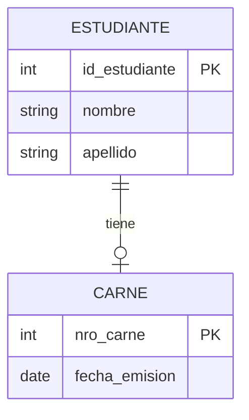
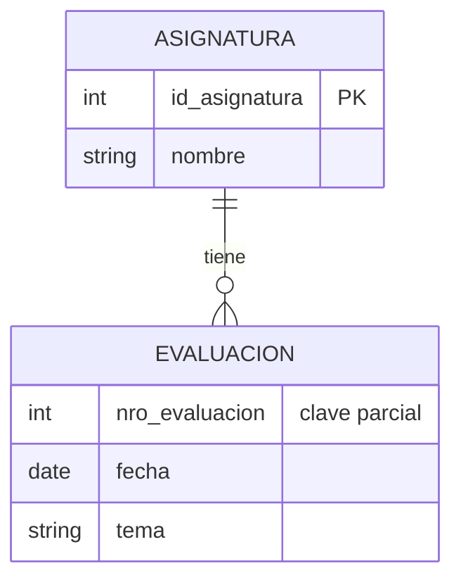

## ¿Qué es una entidad débil?

En el liceo, cada asignatura tiene varias evaluaciones a lo largo del año: la 1, la 2, la 3... Matemática tiene su "evaluación 1" y Física también tiene su "evaluación 1". Entonces, ¿de cuál hablamos cuando decimos "la evaluación 1"? No se puede saber sin nombrar la asignatura. Una **entidad débil** es una entidad que depende de otra, llamada **entidad fuerte**, para existir o para identificarse.

**Características principales:**

- No tiene sentido por sí sola: siempre "cuelga" de una entidad fuerte.
- Si se borra la fuerte, la débil desaparece con ella.
- En la notación de Chen se dibuja con un **rectángulo de doble línea**, y su relación con la fuerte con un **rombo de doble línea**.
- La cardinalidad del lado de la fuerte siempre es (1,1): una evaluación pertenece a una asignatura, ni cero ni dos.

## Dos formas de depender

### 1. Dependencia de existencia

La entidad débil tiene identificador propio, pero no puede existir sin la fuerte. El **carné** de estudiante tiene su número único, pero un carné sin estudiante no significa nada.

*Diagrama: un estudiante tiene como máximo un carné; cada carné pertenece obligatoriamente a un estudiante.*

**Elementos clave:**

- `nro_carne` alcanza para identificar al carné.
- La dependencia es solo de existencia: sin estudiante, no hay carné.

### 2. Dependencia de identificación

La entidad débil **no** tiene un identificador que alcance por sí solo. Necesita "pedirle prestado" el identificador a la fuerte.

*Diagrama: una asignatura tiene muchas evaluaciones; el número de evaluación solo distingue a las evaluaciones dentro de una misma asignatura.*

| id_asignatura | nro_evaluacion | fecha | tema |
| ------------- | -------------- | ----- | ---- |
| 10 (Matemática) | 1 | 2026-04-15 | Funciones |
| 10 (Matemática) | 2 | 2026-06-10 | Derivadas |
| 11 (Física) | 1 | 2026-04-20 | Cinemática |

**¿Qué hace exactamente?**

- `nro_evaluacion` se repite: hay un 1 en Matemática y otro 1 en Física. Por eso se llama **clave parcial** (o discriminador) y en Chen se subraya con línea punteada.
- La pareja (`id_asignatura`, `nro_evaluacion`) sí es única. Esa pareja es el identificador completo de la evaluación.

## ¿Cómo me doy cuenta de que una entidad es débil?

- **Prueba del borrado**: si elimino la entidad fuerte, ¿la otra sigue teniendo sentido? Si la respuesta es no, es débil.
- **Prueba del número repetido**: ¿la numeración "empieza de nuevo" para cada ejemplar de la otra entidad (evaluación 1, 2, 3 de cada asignatura; cuota 1, 2, 3 de cada préstamo)? Entonces depende de ella para identificarse.

Algunos casos típicos son las cuotas de un préstamo, los renglones de una factura, las habitaciones de un hotel y los capítulos de un libro, entre muchos otros.

## Diferencia clave: Existencia vs Identificación

| Aspecto | Dependencia de existencia | Dependencia de identificación |
| ------- | ------------------------- | ----------------------------- |
| ¿Tiene identificador propio? | Sí | No, solo una clave parcial |
| Ejemplo en el liceo | CARNE | EVALUACION |
| ¿Puede existir sin la fuerte? | No | No |
| Identificador completo | El propio (`nro_carne`) | El de la fuerte + la clave parcial |
| Al pasar a tablas | FK hacia la fuerte | FK que además forma parte de la PK |

---

## 📋 Palabras clave

`entidad débil` · `entidad fuerte` · `dependencia de existencia` · `dependencia de identificación` · `clave parcial` · `discriminador` · `relación identificadora` · `rectángulo doble` · `clave compuesta` · `carné` · `evaluación` · `cardinalidad (1,1)`

---

🧠 **[Autoevaluación — Módulo 2](auto-modulo2)**

---

← [Atributos compuestos, multivaluados y derivados](Atributos-compuestos-multivaluados-y-derivados) · [🏠 Inicio](Home) · [Relaciones reflexivas →](Relaciones-reflexivas)
