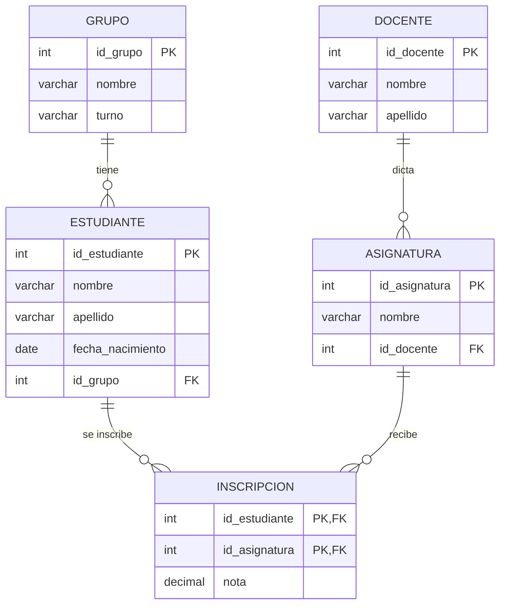

> 🗄️ **Base de datos:** `liceo` (Módulo 7 — Consultas Básicas) — [⬇️ Descargar script SQL](https://github.com/adelvalle2010/conexion-base-de-datos/blob/main/scripts-sql/modulo7/liceo.sql)

# 🔎 SELECT: Sintaxis básica

En este módulo vamos a aprender a **preguntarle** cosas a la base del liceo: qué estudiantes hay, quiénes nacieron antes de cierta fecha, cuáles son las mejores notas. Partimos de la base completa del Módulo 6 y no vamos a modificar ningún dato: solo a leer.

## Introducción

Guardar datos es la mitad del trabajo. La otra mitad es recuperarlos, y de eso se ocupa una sola sentencia: `SELECT`. Es la más usada de todo SQL y también la más rica, por eso le dedicamos dos módulos.

> **¿Qué es una consulta?** Es una pregunta escrita en SQL. La respuesta siempre tiene forma de tabla (filas y columnas), aunque sea de una sola celda. Esa tabla de respuesta se llama **conjunto de resultados** y no se guarda en ningún lado: se calcula cada vez.

## Requisitos que vamos a necesitar

1. MySQL y Workbench funcionando: [Conexión al servidor y primeros pasos](Conexion-al-servidor-y-primeros-pasos).
2. La base `liceo` con sus datos. Si hiciste el Módulo 6 completo, ya la tenés. Si no, o si la modificaste probando cosas, el script de este módulo la deja como nueva.

## La Base de Datos del módulo



*Diagrama: las cinco tablas de la base `liceo` y sus relaciones.*

| Tabla | Filas | Contenido |
| ----- | ----- | --------- |
| `grupo` | 4 | 3ºA, 3ºB, 2ºA y 2ºB, con su turno |
| `docente` | 5 | Los docentes del liceo |
| `asignatura` | 6 | De la 10 (Matemática) a la 15 (Filosofía) |
| `estudiante` | 10 | Con fecha de nacimiento y grupo |
| `inscripcion` | 21 | Qué estudiante cursa qué asignatura, y su nota (de 1 a 12) |

## Cómo cargar el script

1. Descargá `liceo.sql` desde el enlace de arriba.
2. En Workbench: **File → Open SQL Script…**, elegí el archivo y ejecutalo completo con el rayo ⚡.
3. Elegí la base: `USE liceo;`

Por consola: `mysql -u root -p < liceo.sql`

> 📌 **Nota:** el script empieza con `DROP DATABASE IF EXISTS liceo;`. Ejecutarlo borra cualquier cambio que hayas hecho en esa base y la deja en su estado original.

---

## Sintaxis

```sql
SELECT <columnas>
FROM <tabla>;
```

```text
SELECT nombre, apellido      ← QUÉ columnas quiero ver
FROM estudiante;             ← DE QUÉ tabla salen
```

---

## Paso 1 — Todas las columnas

El asterisco significa "todas las columnas":

```sql
SELECT *
FROM grupo;
```

**Resultado:**

| id_grupo | nombre | turno |
| -------- | ------ | ----- |
| 1 | 3ºA | matutino |
| 2 | 3ºB | vespertino |
| 3 | 2ºA | matutino |
| 4 | 2ºB | nocturno |

Es cómodo para explorar una tabla que no conocemos, pero tiene sus costos, como veremos más abajo.

---

## Paso 2 — Solo algunas columnas

```sql
SELECT nombre, apellido
FROM estudiante;
```

**Resultado:**

| nombre | apellido |
| ------ | -------- |
| Lucía | Fernández |
| Mateo | Silva |
| Valentina | Rodríguez |
| Santiago | Pérez |
| Camila | González |
| Joaquín | Martínez |
| Sofía | López |
| Benjamín | Castro |
| Martina | Suárez |
| Agustín | Núñez |

**Elementos clave:**

- Las columnas se separan con comas y aparecen **en el orden en que las pedimos**, no en el de la tabla.
- La tabla `estudiante` no cambió: `SELECT` nunca modifica datos.
- Limitar las columnas a las que hacen falta se llama **proyección**.

---

## Paso 3 — Cambiarle el nombre a una columna: AS

```sql
SELECT nombre AS asignatura, id_docente AS dictada_por
FROM asignatura;
```

**Resultado:**

| asignatura | dictada_por |
| ---------- | ----------- |
| Matemática | 1 |
| Física | 2 |
| Historia | 3 |
| Química | 4 |
| Programación | 4 |
| Filosofía | 3 |

**¿Qué hace exactamente?**

- `AS` define un **alias**: un nombre para la columna en el resultado. La tabla sigue teniendo sus nombres originales.
- Si el alias lleva espacios, va entre comillas: `AS 'dictada por'`. Es más simple usar guion bajo.
- La palabra `AS` se puede omitir (`SELECT nombre asignatura`), pero escribirla evita confusiones.

---

## Paso 4 — Columnas calculadas

Un `SELECT` puede mostrar valores que no están guardados, calculándolos a partir de los que sí están:

```sql
SELECT nombre,
       fecha_nacimiento,
       YEAR(fecha_nacimiento) AS anio_nacimiento,
       2026 - YEAR(fecha_nacimiento) AS edad_a_fin_de_2026
FROM estudiante;
```

**Resultado:**

| nombre | fecha_nacimiento | anio_nacimiento | edad_a_fin_de_2026 |
| ------ | ---------------- | --------------- | ------------------ |
| Lucía | 2009-03-14 | 2009 | 17 |
| Mateo | 2008-11-02 | 2008 | 18 |
| Valentina | 2009-07-21 | 2009 | 17 |
| Santiago | 2009-01-30 | 2009 | 17 |
| Camila | 2008-09-09 | 2008 | 18 |
| Joaquín | 2010-05-17 | 2010 | 16 |
| Sofía | 2010-02-03 | 2010 | 16 |
| Benjamín | 2010-12-25 | 2010 | 16 |
| Martina | 2009-06-06 | 2009 | 17 |
| Agustín | 2008-04-18 | 2008 | 18 |

```sql
SELECT CONCAT(nombre, ' ', apellido) AS nombre_completo
FROM docente;
```

**Resultado:**

| nombre_completo |
| --------------- |
| Ana Pereira |
| Carlos Méndez |
| Laura Sosa |
| Diego Olivera |
| Marta Giménez |

**Elementos clave:**

- Se pueden usar los operadores `+`, `-`, `*` y `/`.
- `YEAR()` extrae el año de una fecha y `CONCAT()` une textos. Son **funciones**; hay muchas más en el [Anexo: Funciones de texto, número y fecha](Anexo-Funciones-de-MySQL).
- Esto es lo que en el Módulo 2 llamamos **atributo derivado**: la edad no se guarda, se calcula al consultar.
- Si no se le pone alias, la columna calculada se llama igual que la fórmula, lo que queda ilegible.

---

## Paso 5 — Sin repetidos: DISTINCT

¿En qué grupos hay estudiantes?

```sql
SELECT id_grupo
FROM estudiante;
```

**Resultado:**

| id_grupo |
| -------- |
| 1 |
| 1 |
| 1 |
| 2 |
| 2 |
| 2 |
| 2 |
| 3 |
| 3 |
| 3 |

Diez filas, una por estudiante. Para ver cada valor una sola vez:

```sql
SELECT DISTINCT id_grupo
FROM estudiante;
```

**Resultado:**

| id_grupo |
| -------- |
| 1 |
| 2 |
| 3 |

**¿Qué hace exactamente?**

- `DISTINCT` elimina las filas repetidas **del resultado**.
- Con varias columnas, compara la combinación completa: `SELECT DISTINCT nombre, apellido` solo quita las filas en que coinciden las dos.
- El grupo 4 no aparece: no tiene estudiantes.

---

## Diferencia clave: SELECT * vs SELECT con columnas

| Aspecto | `SELECT *` | `SELECT columna, columna` |
| ------- | ---------- | ------------------------- |
| Qué trae | Todas las columnas | Solo las pedidas |
| Si se agrega una columna a la tabla | El resultado cambia | El resultado sigue igual |
| Cantidad de datos que viajan | Todos, se usen o no | Los necesarios |
| Legibilidad | No se sabe qué devuelve sin mirar la tabla | Se lee en la propia consulta |
| Cuándo usar | Para explorar, a mano | En scripts y en aplicaciones |

## ⚠️ Errores frecuentes

| Síntoma | Causa | Solución |
| ------- | ----- | -------- |
| `Error 1054: Unknown column 'nombres' in 'field list'` | El nombre de la columna está mal escrito | Revisar con `DESCRIBE estudiante;` |
| `Error 1146: Table 'liceo.estudiantes' doesn't exist` | El nombre de la tabla está mal (las nuestras van en singular) | Revisar con `SHOW TABLES;` |
| `Error 1046: No database selected` | Falta `USE liceo;` | Elegir la base |
| `Error 1064` cerca de `FROM` | Sobra una coma después de la última columna | `SELECT nombre, apellido FROM…`, sin coma antes de `FROM` |
| Aparece una sola columna con un nombre raro | Faltó una coma: `SELECT nombre apellido` toma `apellido` como alias | Agregar la coma |

---

Continuamos por cómo quedarnos solo con algunas filas → [WHERE: Filtrado de datos](WHERE-filtrado-de-datos)

---

## ✍️ Ejercicios

Resolvé cada uno antes de mirar la solución.

**1.** Mostrá todo el contenido de la tabla `docente`.

<details>
<summary>Ver solución</summary>

```sql
SELECT *
FROM docente;
```

| id_docente | nombre | apellido |
| ---------- | ------ | -------- |
| 1 | Ana | Pereira |
| 2 | Carlos | Méndez |
| 3 | Laura | Sosa |
| 4 | Diego | Olivera |
| 5 | Marta | Giménez |

💡 Para una tabla chica que estamos explorando, el asterisco es lo más práctico.
</details>

**2.** Mostrá el nombre y el turno de cada grupo, con las columnas tituladas `grupo` y `horario`.

<details>
<summary>Ver solución</summary>

```sql
SELECT nombre AS grupo, turno AS horario
FROM grupo;
```

| grupo | horario |
| ----- | ------- |
| 3ºA | matutino |
| 3ºB | vespertino |
| 2ºA | matutino |
| 2ºB | nocturno |

💡 El alias cambia el título de la columna en el resultado, no en la tabla.
</details>

**3.** ¿Qué turnos distintos existen en el liceo?

<details>
<summary>Ver solución</summary>

```sql
SELECT DISTINCT turno
FROM grupo;
```

| turno |
| ----- |
| matutino |
| vespertino |
| nocturno |

💡 Hay cuatro grupos pero solo tres turnos: `matutino` aparece dos veces en la tabla y una en el resultado.
</details>

**4.** Mostrá el apellido y el nombre de cada estudiante en una sola columna llamada `estudiante`, con el formato "Fernández, Lucía".

<details>
<summary>Ver solución</summary>

```sql
SELECT CONCAT(apellido, ', ', nombre) AS estudiante
FROM estudiante;
```

| estudiante |
| ---------- |
| Fernández, Lucía |
| Silva, Mateo |
| Rodríguez, Valentina |
| Pérez, Santiago |
| González, Camila |
| Martínez, Joaquín |
| López, Sofía |
| Castro, Benjamín |
| Suárez, Martina |
| Núñez, Agustín |

💡 `CONCAT` acepta todos los textos que hagan falta; la coma y el espacio son un texto más, entre comillas.
</details>

---

## 📋 Palabras clave

`SELECT` · `FROM` · `consulta` · `conjunto de resultados` · `asterisco` · `proyección` · `alias` · `AS` · `columna calculada` · `CONCAT` · `YEAR` · `DISTINCT` · `función` · `DQL`

---

🧠 **[Autoevaluación — Módulo 7](auto-modulo7)**

---

← [Resumen del Módulo 6](Resumen-Modulo6) · [🏠 Inicio](Home) · [WHERE: Filtrado de datos →](WHERE-filtrado-de-datos)
