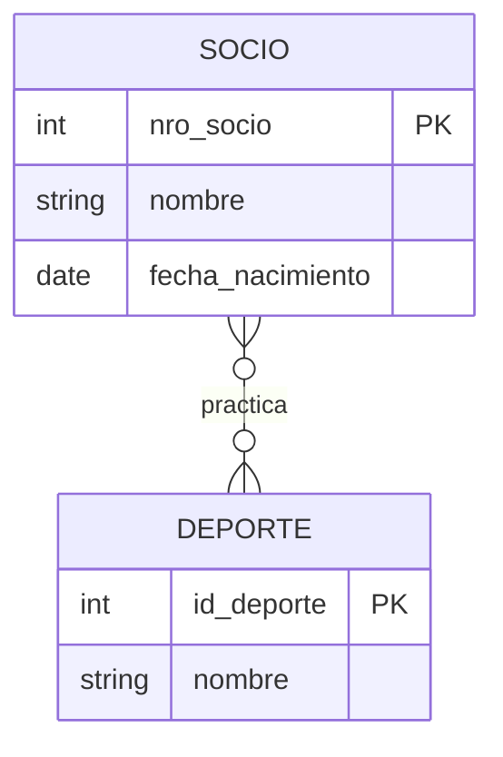
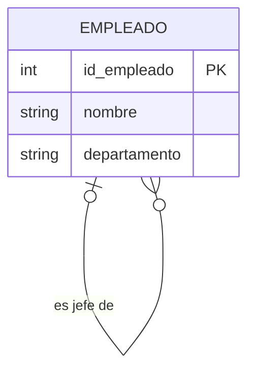
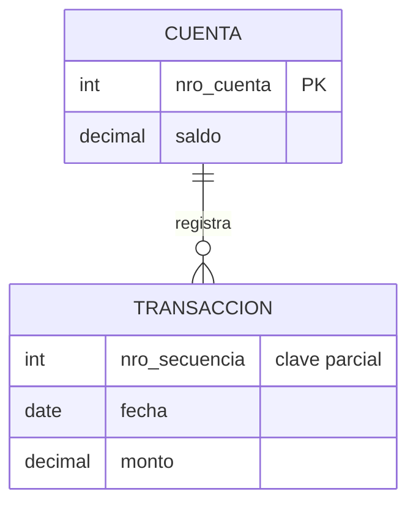
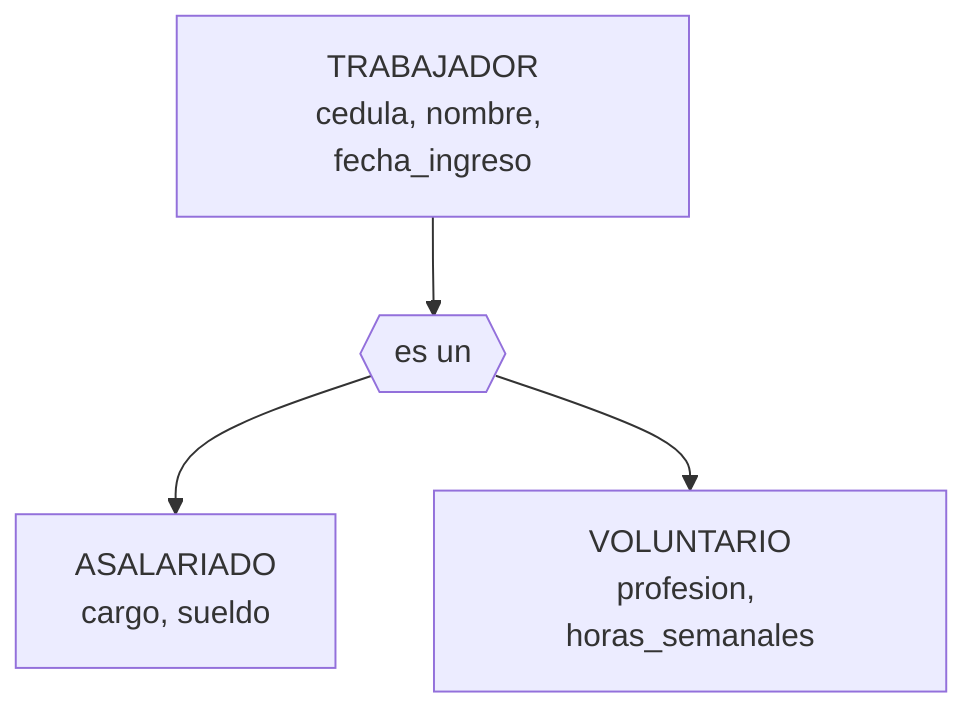
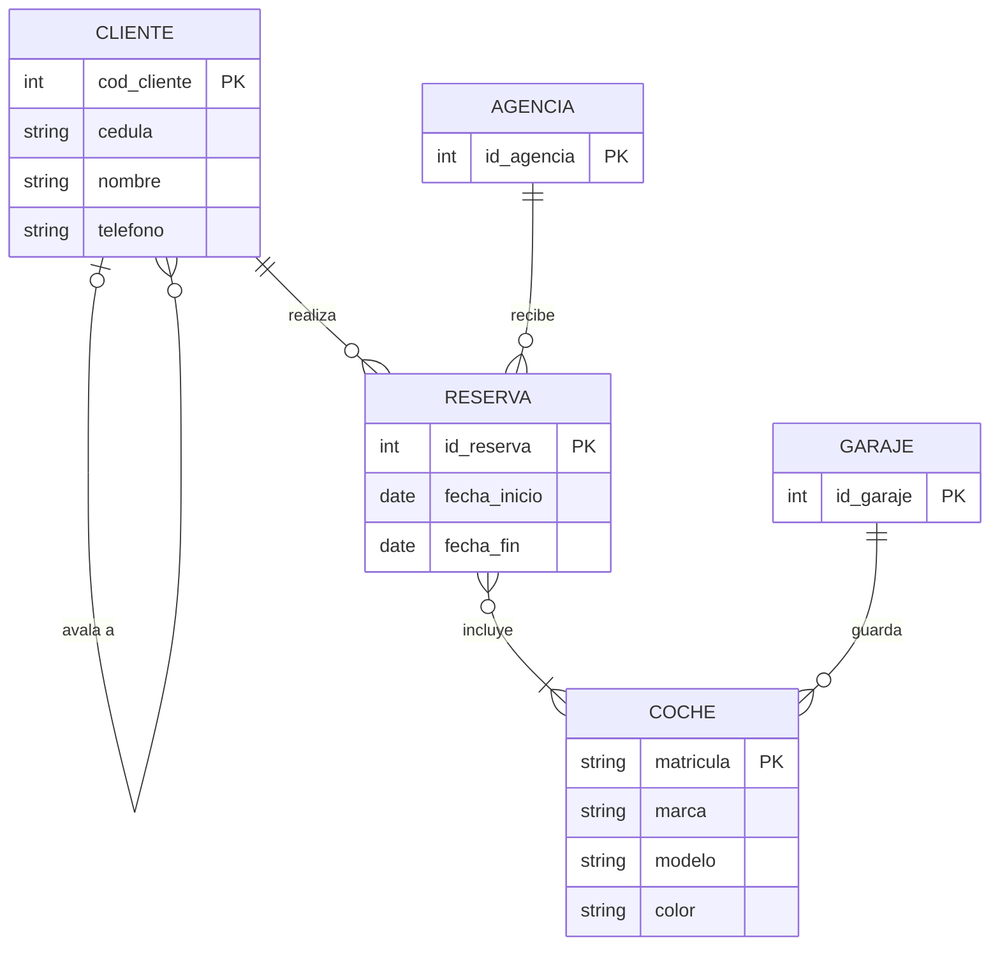

## Solución: Diseño avanzado

> ⚠️ Intentá resolver los ejercicios antes de mirar esta página.

Los diagramas se muestran con sintaxis `mermaid`. Las piezas que ese dibujo no puede mostrar (atributos derivados, entidades débiles, atributos de relaciones) se indican debajo de cada diagrama.

---

### Ejercicio 1



Atributo derivado de SOCIO: `edad` (óvalo punteado en Chen).

```text
socio(nro_socio PK, nombre, fecha_nacimiento)
deporte(id_deporte PK, nombre)
practica(nro_socio PK/FK → socio, id_deporte PK/FK → deporte)
```

**Explicación:** la edad es un atributo **derivado**: se calcula con `fecha_nacimiento` y la fecha de hoy. Se dibuja, pero no es columna de ninguna tabla. La relación N:M se resuelve con la tabla intermedia `practica`.

**Error común:** agregar la columna `edad` "para tenerla a mano". El día del cumpleaños de cada socio el dato quedaría mal.

---

### Ejercicio 2



```text
empleado(id_empleado PK, nombre, departamento, id_jefe* FK → empleado)
```

**Explicación:** es una relación **reflexiva 1:N** con los roles *jefe* y *subordinado*. Se resuelve con una FK que apunta a la misma tabla. `id_jefe` admite `NULL` porque el gerente general no tiene jefe.

**Error común:** crear una tabla `jefe` con los mismos datos que `empleado`. Los datos de la misma persona quedarían en dos lugares.

---

### Ejercicio 3



TRANSACCION es entidad débil (rectángulo doble en Chen).

```text
cuenta(nro_cuenta PK, saldo)
transaccion(nro_cuenta PK/FK → cuenta, nro_secuencia PK, fecha, monto)
```

**Explicación:** TRANSACCION es **débil por identificación**: `nro_secuencia` se repite entre cuentas, así que es solo una clave parcial. La PK es la pareja (`nro_cuenta`, `nro_secuencia`).

**Error común:** dejar `nro_secuencia` como única PK. La transacción 1 de la segunda cuenta no se podría cargar, porque ya existe un 1.

---

### Ejercicio 4



Atributo multivaluado de TRABAJADOR: `telefono`.

La especialización es **exclusiva** (nadie es de los dos tipos) y **total** (todos son de alguno).

```text
trabajador(cedula PK, nombre, fecha_ingreso)
asalariado(cedula PK/FK → trabajador, cargo, sueldo)
voluntario(cedula PK/FK → trabajador, profesion, horas_semanales)
telefono_trabajador(cedula PK/FK → trabajador, telefono PK)
```

**Explicación:** se eligió la estrategia 1 (supertipo + subtipos) porque el teléfono es de **cualquier** trabajador: con una tabla `trabajador`, `telefono_trabajador` tiene una sola FK a la que apuntar.

**Alternativa:** al ser exclusiva y total, la estrategia 2 (solo `asalariado` y `voluntario`) también es válida, pero obligaría a tener dos tablas de teléfonos.

---

### Ejercicio 5



Piezas especiales:

- `direccion` de CLIENTE es **compuesto** (calle, número, ciudad).
- `precio_total` de RESERVA es **derivado**: suma de los precios de alquiler de sus coches.
- "avala a" es una relación **reflexiva 1:N**.
- La relación "incluye" es N:M y tiene atributos: `precio_alquiler` y `litros_nafta`.

```text
cliente(cod_cliente PK, cedula, nombre, calle, numero, ciudad, telefono, cod_avalista* FK → cliente)
agencia(id_agencia PK)
garaje(id_garaje PK)
coche(matricula PK, marca, modelo, color, id_garaje FK → garaje)
reserva(id_reserva PK, fecha_inicio, fecha_fin, cod_cliente FK → cliente, id_agencia FK → agencia)
reserva_coche(id_reserva PK/FK → reserva, matricula PK/FK → coche, precio_alquiler, litros_nafta)
```

**Explicación:** el enunciado no da identificador para RESERVA, AGENCIA ni GARAJE, así que se agregó uno a cada una. `precio_total` no es columna: se obtiene sumando `precio_alquiler` en `reserva_coche`. `cod_avalista` admite `NULL` porque el aval es opcional.

**Error común:** poner `precio_alquiler` en `coche`. El enunciado dice que se anota **por cada coche de una reserva**: el mismo coche puede alquilarse a precios distintos en reservas distintas.

---

🧠 **[Autoevaluación — Módulo 2](auto-modulo2)**

---

← [Ejercicios: Diseño avanzado](Ejercicios-Diseno-avanzado) · [🏠 Inicio](Home) · [Resumen del Módulo 2 →](Resumen-Modulo2)
