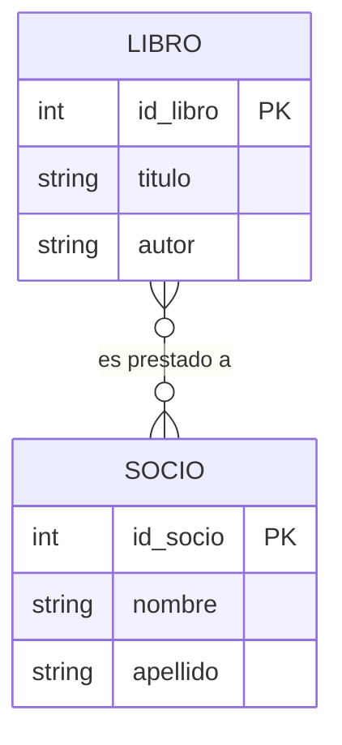
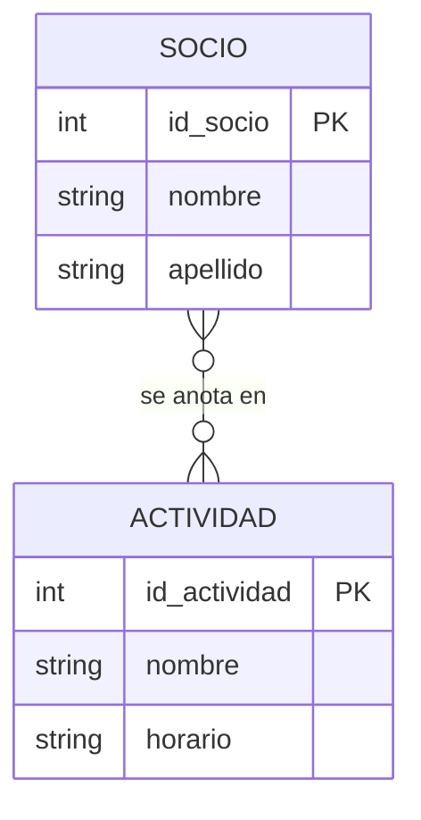
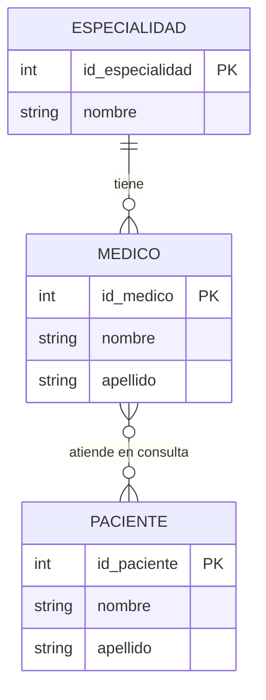
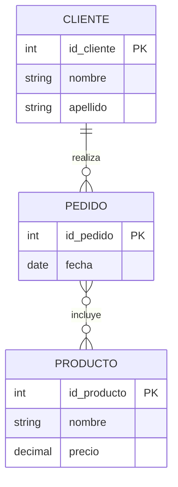
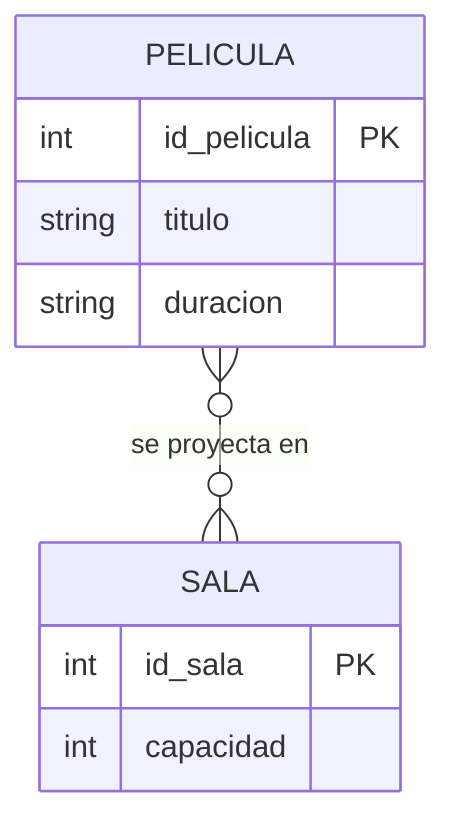

## Solución: Entidad-Relación

> ⚠️ Intentá resolver los ejercicios antes de mirar esta página.

Los diagramas se muestran con sintaxis `mermaid`. Los atributos de las relaciones (que ese dibujo no puede mostrar) se indican debajo de cada diagrama.

---

### Ejercicio 1

Atributos de la relación (préstamo): `fecha_prestamo` y `fecha_devolucion`.

**Explicación:** hay dos entidades, LIBRO y SOCIO, cada una con su identificador. La relación es **N:M**: un socio se lleva muchos libros y un libro pasa por muchos socios. Las fechas no son de ninguno de los dos por separado, sino de cada préstamo, así que son atributos de la relación.

**Error común:** dibujar la relación como 1:N pensando "un libro está prestado a un solo socio". Eso es cierto en un instante, pero a lo largo del tiempo el mismo libro va pasando por muchos socios.

---

### Ejercicio 2

Atributo de la relación: `fecha_alta`.

**Explicación:** la relación es **N:M**. La fecha de alta no es del socio (un mismo socio se anotó en cada actividad en una fecha distinta) ni de la actividad (cada socio se anotó en un día diferente). Pertenece al par (socio, actividad), por eso es un atributo de la relación.

**Error común:** poner `fecha_alta` dentro de SOCIO. Entonces solo se podría guardar una fecha por socio, aunque esté anotado en tres actividades.

---

### Ejercicio 3

Atributos de la relación (consulta): `fecha`, `hora` y `diagnostico`.

**Explicación:** ESPECIALIDAD–MEDICO es **1:N** (cada médico tiene una sola especialidad; una especialidad la tienen varios médicos). MEDICO–PACIENTE es **N:M**. Los datos de la consulta pertenecen a cada encuentro entre un médico y un paciente.

**Error común:** poner `diagnostico` en PACIENTE. Un mismo paciente puede tener diagnósticos distintos en cada consulta, y con distintos médicos.

---

### Ejercicio 4

**a)**

Atributo de la relación PEDIDO–PRODUCTO: `cantidad`.

**Explicación:** CLIENTE–PEDIDO es **1:N** y PEDIDO–PRODUCTO es **N:M**. La cantidad pertenece al par (pedido, producto): en un pedido se pueden llevar 3 unidades de un producto y 1 de otro.

**b)** Si hubiera un solo pedido por cliente en toda su vida, la relación pasaría a ser **1:1**. Y entonces habría que preguntarse si hacen falta dos entidades: los datos del pedido podrían guardarse junto a los del cliente. En la práctica se suelen mantener separadas porque esa regla del negocio puede cambiar.

**Error común:** dibujar CLIENTE–PEDIDO como N:M. Un pedido no lo hacen varios clientes a la vez.

---

### Ejercicio 5

**Errores encontrados:**

1. **PELICULA no tiene identificador.** Sin `PK`, no hay forma segura de distinguir dos películas con el mismo título.
2. **El atributo `sala` está de más.** La relación con SALA ya expresa en qué sala se proyecta una película; guardarlo además como atributo lo repite y puede quedar inconsistente.
3. **La cardinalidad es 1:1 y debería ser N:M.** El dibujo dice que cada película se proyecta en una sola sala y que cada sala proyecta una sola película, contra lo que dice el enunciado.

**Versión corregida:**

Atributo de la relación (función): `fecha_hora`.

**Explicación:** el horario de una proyección no es de la película ni de la sala, sino de cada combinación entre ambas: es un atributo de la relación.

**Error común:** corregir solo la cardinalidad y dejar el atributo `sala` dentro de PELICULA. Es un error "escondido" porque el diagrama parece correcto a simple vista.

---

← [Ejercicios: Entidad-Relación](Ejercicios-Entidad-Relacion) · [🏠 Inicio](Home) · [Modelo Relacional →](Modelo-Relacional)
